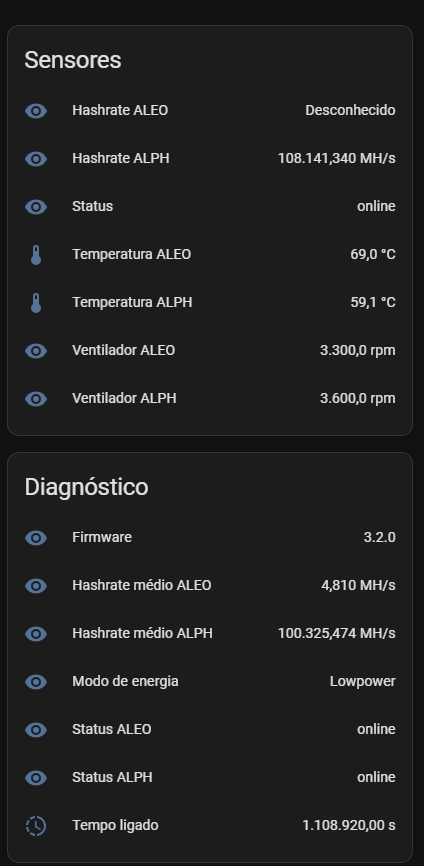

# Goldshell Hub for Home Assistant

Monitor **Goldshell** miners through the **Goldshell Hub** cloud
(`hub.goldshell.com`) instead of the miner's local network. Because the data
comes from the cloud, the miner can sit on **any network with internet access** —
no VPN, no port forwarding, no access to the remote LAN required. The miner only
needs **Cloud Control** enabled (System → Cloud Control Settings, with your
Account Key).

> Unofficial integration. It uses the same private API that the Goldshell Hub
> web app uses. Goldshell may change it at any time. Not affiliated with
> Goldshell.

## Screenshots

## Features

- One **device per miner** on your account, discovered automatically.
- **Per-hashboard** sensors: hashrate (current and average), temperature, fan
  speed and board status.
- **Per-miner** sensors: status, firmware version, power mode and uptime.
- **QR-code login** in the config flow — the same scan-with-the-app flow the Hub
  website uses. No password or token copy-pasting.
- Automatic **re-authentication**: when the token expires the integration opens
  a repair/re-auth prompt to scan a new QR code.

## Installation (HACS)

1. HACS → ⋮ → **Custom repositories** → add `https://github.com/rngarcia/ha-goldshell-hub`, category **Integration**.
2. Install **Goldshell Hub** and restart Home Assistant.
3. **Settings → Devices & Services → Add Integration → Goldshell Hub**.
4. Scan the QR code with the Goldshell phone app and approve.

Manual install: copy `custom_components/goldshell_hub` into your HA
`config/custom_components/` folder and restart.

## The 30-day token

The Hub authenticates with a JWT that is valid for ~30 days and has **no refresh
endpoint** — this is a Goldshell limitation, not a bug in the integration. When
it expires, Home Assistant raises a re-authentication notification; scan a new QR
code and you are back online. Everything else is automatic.

## Units

The Hub reports hashrate in **MH/s** (verified on the Goldshell Byte: an ALPH
board reporting `100326` = 100.33 GH/s, an ALEO board reporting `4.824` =
4.82 MH/s). Sensors expose the raw MH/s value; convert in a template or the
dashboard if you prefer GH/s. Other models were not tested — open an issue with a
sample if a value looks off.

## How it works

- `GET /api/v1/user/code` → a login `code` and `q_link` (the QR payload), valid 5 min.
- `GET /api/v1/user/check?code=…` is polled every 5 s; once you approve in the
  app it returns `access_token` (the 30-day JWT).
- The token is sent as a bare `token:` header on
  `GET /api/v1/machines?page=1&pagesize=100`, which returns every machine and its
  boards.

## Publishing / maintainers

This repo is HACS-ready: `custom_components/goldshell_hub/` + root `hacs.json`
and `README.md`, a `brand/` icon, and a `.github/workflows/validate.yml` that
runs the **HACS action** and **hassfest**. To get into the HACS default store:

1. Make the repo **public**, give it a **description** and at least one **topic**
   (e.g. `home-assistant`, `hacs`, `goldshell`), and keep issues enabled.
2. Ensure the **Validate** workflow passes (HACS + hassfest, no errors).
3. Cut a **GitHub release** (a real release, not just a tag).
4. Open a PR adding this repo to the `integration` list in
   [hacs/default](https://github.com/hacs/default).

The icon ships with the integration: Home Assistant 2026.3+ serves the images in
`custom_components/goldshell_hub/brand/` through its Brands Proxy API, so **no
`home-assistant/brands` PR is needed** (custom-integration PRs there are no longer
accepted).

## Support

If this integration is useful to you, you can [buy me a beer](https://www.paypal.com/donate/?business=rngarcia%40gmail.com&currency_code=USD) 🍺.

## Disclaimer

Provided as-is under the MIT license. Use with your own account and your own
miners. The API is undocumented and may break without notice.
